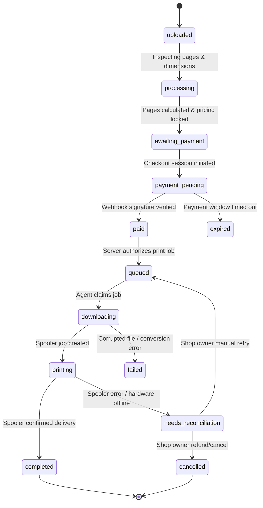

# PrintFlow — Architecture & Technical Specifications

## 1. System Overview
PrintFlow is a production-grade multi-tenant QR-automated document printing platform designed for commercial photocopy/print shops, university copy centers, and enterprise self-service kiosks.

The architecture decouples the high-friction customer experience (file transfer, page counting, payment) from the physical print execution by connecting an ultra-fast web interface directly to local Windows Print Spoolers via a secure outbound daemon agent.

```mermaid
flowchart TD
    Customer([Smartphone Customer]) -->|1. Scans Permanent Shop QR| WebApp[Next.js Customer App]
    Customer -->|2. Uploads Documents| WebApp
    WebApp -->|3. Signed Upload & Parsing| Storage[(Supabase Storage & Doc Parser)]
    Customer -->|4. Configures Print Settings| WebApp
    WebApp -->|5. Creates Order & Requests Payment| API[PrintFlow Server API]
    API -->|6. Dynamic UPI QR / Checkout| PaymentGateway[Razorpay / Cashfree Gateway]
    Customer -->|7. UPI Payment| PaymentGateway
    PaymentGateway -->|8. Signed Webhook| API
    API -->|9. Verify Signature & Authorize Job| DB[(Supabase PostgreSQL / RLS)]
    API -->|10. Push Job Event| Realtime[Supabase Realtime / WebSocket Queue]
    Realtime -->|11. Pull / Receive Job| WinAgent[PrintFlow Windows Desktop Agent]
    WinAgent -->|12. Download & Process Document| WinAgent
    WinAgent -->|13. Submit Spooler Job| WindowsSpooler[Windows Print Spooler (USB / Wi-Fi)]
    WindowsSpooler -->|14. Hardware Execution| PhysicalPrinter[Printer Hardware]
    WinAgent -->|15. Heartbeat & Job Status Update| API
    Realtime -->|16. Live Status Broadcast| WebApp
```

---

## 2. Multi-Tenant Architecture & Data Isolation

### 2.1 Tenant Boundary (`shop_id`)
- Every physical printing business is a **Tenant** represented by a record in `shops`.
- All operational tables (`printers`, `devices`, `orders`, `order_files`, `order_items`, `payments`, `print_jobs`, `print_job_events`, `agent_heartbeats`, `shop_pricing`) strictly enforce foreign keys to `shops(id)`.
- Shop isolation is secured using PostgreSQL **Row Level Security (RLS)** policies combined with verified JWT claims.
- The platform supports:
  - **Super Admin**: System owner with global cross-tenant management privileges.
  - **Shop Owner / Staff**: Scoped strictly to their registered `shop_id`.
  - **Public Customers**: Anonymous / authenticated session scoped to placing an order under a public shop slug.
  - **Device / Agent**: Dedicated device tokens scoped to a single `shop_id` and `device_id`.

---

## 3. Print Job State Machine

To guarantee zero duplicate physical prints, atomic job claiming, and full reconciliation upon power/network failure, jobs follow a deterministic state machine:



### 3.1 Idempotency & Concurrency Rules
1. **Payment Webhooks**: Unique constraint on `(payment_provider, transaction_id)` ensures webhook deduplication.
2. **Job Claiming**: Agents claim jobs via atomic PostgreSQL `UPDATE print_jobs SET status = 'downloading', claimed_at = now(), device_id = :device_id WHERE id = :job_id AND status = 'queued' RETURNING *`.
3. **No Blind Retries**: If Windows spooler returns a status indicating a potential paper jam or job freeze, the agent marks the job as `needs_reconciliation` instead of sending a new copy to avoid double printing.

---

## 4. Windows Desktop Print Agent Design

### 4.1 Communication Model
- **Outbound Only**: The Windows Agent communicates using outbound HTTPS / WSS connections to the Supabase Realtime channel and Next.js REST API.
- **No Inbound Open Ports**: Prevents network firewall blocking and security vulnerabilities in retail environments.
- **Device Pairing Flow**:
  1. Shop owner clicks "Pair New Computer" on the dashboard.
  2. Server generates a single-use 6-digit numeric pairing PIN with a 10-minute expiry.
  3. Owner enters the PIN in the PrintFlow Windows Agent desktop UI.
  4. Server validates PIN, assigns a persistent `device_id`, issues a secure device secret token, and stores hardware fingerprint (MAC, Computer Name).
  5. The Agent saves credentials in Windows DPAPI / encrypted storage.

### 4.2 Windows Spooler & Hardware Integration
- Enumerates local USB and Wi-Fi network printers using Windows `EnumPrinters` / `win32print`.
- Queries `PRINTER_INFO_2` for port names (`USB001`, `WSD-xxx`, `192.168.x.x`), status flags (Paper Out, Door Open, Offline), and driver capabilities.
- Supports native rendering using Windows GDI / direct PDF print submission, or fallback to PyMuPDF headless conversion to print spool streams with explicit DEVMODE flags for:
  - Color mode (`DMCOLOR_MONOCHROME` vs `DMCOLOR_COLOR`)
  - Duplex mode (`DMDUP_SIMPLEX`, `DMDUP_VERTICAL`, `DMDUP_HORIZONTAL`)
  - Paper orientation (`DMORIENT_PORTRAIT`, `DMORIENT_LANDSCAPE`)
  - Paper size (`DMPAPER_A4`, `DMPAPER_A3`, etc.)
- In mock mode (for automated tests and cross-platform dev), virtual mock printer emulates realistic queue latency and status transitions.

---

## 5. Security & Privacy Guarantees
1. **Document Storage**: Customer uploads are kept in a private Supabase Storage bucket (`printflow-documents`) with no public read access.
2. **Expiring Signed URLs**: The Windows Agent downloads documents via time-limited (max 10-minute) presigned URLs.
3. **Automatic Retention Policy**: Files are flagged for deletion immediately after job completion or 24 hours after order expiration.
4. **Payment Isolation**: Server-side secrets (`RAZORPAY_KEY_SECRET`, `CASHFREE_SECRET_KEY`, `SUPABASE_SERVICE_ROLE_KEY`) are never exposed to browser clients or Desktop agent builds.
